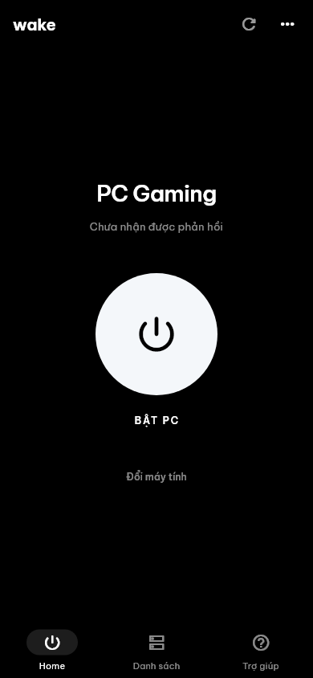
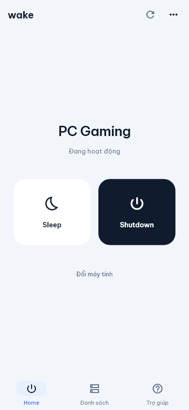
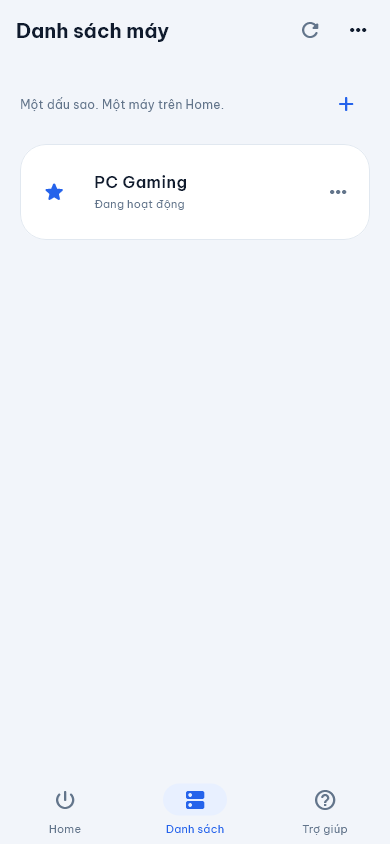
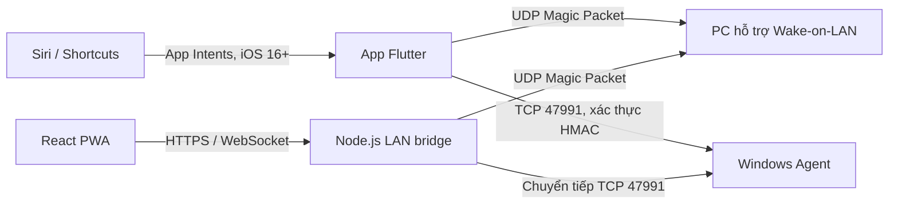

# Wake My PC

Bật PC trong mạng nội bộ bằng Wake-on-LAN; Sleep, Shutdown và điều khiển chuột/phím
qua Windows Agent. Giao diện tiếng Việt, lưu dữ liệu trên thiết bị và không yêu cầu tài khoản.

**[Tải Windows Agent](https://github.com/Nakai981/wake-on-lan/releases/latest/download/WakeMyPcAgent.exe)**
· **[GitHub Releases](https://github.com/Nakai981/wake-on-lan/releases)**
· **[Hướng dẫn bản web](web-react/README.md)**

> **Trạng thái iOS:** đã có mã tích hợp Siri với câu lệnh tiếng Anh cho iOS 16+.
> Phần Swift, nhận giọng nói và Wake trên iPhone chưa được build/kiểm thử trên thiết bị thật.
> Cần macOS, Xcode và cấu hình ký ứng dụng để cài bản iOS.

## Mục lục

- [Các thành phần](#các-thành-phần)
- [Tính năng](#tính-năng)
- [Giao diện](#giao-diện)
- [Bắt đầu với app Flutter](#bắt-đầu-với-app-flutter)
- [Windows Agent](#windows-agent)
- [Siri trên iPhone](#siri-trên-iphone)
- [Bản web PWA](#bản-web-pwa)
- [Cách hoạt động](#cách-hoạt-động)
- [Giới hạn và bảo mật](#giới-hạn-và-bảo-mật)
- [Phát triển và kiểm thử](#phát-triển-và-kiểm-thử)
- [Cấu trúc dự án](#cấu-trúc-dự-án)

## Các thành phần

| Thành phần | Nền tảng | Vai trò |
| --- | --- | --- |
| [App Flutter](lib/) | Android, iOS | Gửi Wake-on-LAN trực tiếp từ điện thoại; ghép nối và điều khiển PC qua Agent |
| [Web PWA](web-react/README.md) | Trình duyệt điện thoại, máy tính | Giao diện React + Vite; dùng Node.js LAN bridge để truy cập mạng nội bộ |
| [Windows Agent](windows-agent/README.md) | Windows 10/11, .NET Framework 4.8 | Nhận lệnh Sleep/Shutdown, chuột và bàn phím đã xác thực; chạy ở khay hệ thống |

**App Flutter không cần LAN bridge.** Bản web cần bridge trên NAS, Raspberry Pi
hoặc một máy khác luôn bật trong cùng LAN. Nếu bridge nằm trên chính PC cần bật,
bridge sẽ ngừng hoạt động khi PC Sleep/tắt.

## Tính năng

- Gửi Magic Packet UDP, tùy chỉnh broadcast, cổng, số lần gửi và thời gian theo dõi.
- Quét LAN với tối đa 12 tác vụ song song; nhập MAC/IP thủ công hoặc thêm PC bằng QR Agent.
- Lưu nhiều PC, chọn một PC mặc định bằng ngôi sao, chỉnh sửa/xóa thiết bị và lưu 60 hoạt động gần nhất.
- Theo dõi trạng thái khi app ở foreground, cảnh báo đổi subnet và hướng dẫn chẩn đoán kết nối.
- Sleep/Shutdown có xác nhận, hỗ trợ hủy lệnh đang chờ qua Windows Agent.
- Lưu thời gian chờ chung cho Sleep/Shutdown: **1 giây đến 24 giờ**, mặc định **10 giây**.
- Touchpad, nhấp/kéo/cuộn, Touch Bar, media/âm lượng, phím tắt và bàn phím Unicode qua Agent;
  có chế độ xem trước khi chưa ghép nối.
- Siri/App Shortcuts trên iPhone với câu lệnh, lời xác nhận và phản hồi tiếng Anh.
- Giao diện sáng/tối và font Be Vietnam Pro đóng gói sẵn, không tải font khi chạy.

Đổi thời gian chờ trong **Không gian của bạn → Thời gian chờ tắt / Sleep** rồi lưu.
Thiết lập được giữ sau khi mở lại app và chỉ áp dụng cho lệnh tiếp theo.
Thời gian chờ tùy chỉnh cần Agent được build từ mã nguồn hỗ trợ tính năng này.

## Giao diện

<table>
  <tr>
    <th>Home khi chưa xác nhận PC hoạt động</th>
    <th>Home khi PC đang phản hồi</th>
    <th>Danh sách PC</th>
  </tr>
  <tr>
    <td></td>
    <td></td>
    <td></td>
  </tr>
</table>

Ảnh minh họa được render từ widget với trạng thái giả lập; không phải bằng chứng PC vật lý đã bật/tắt.

## Bắt đầu với app Flutter

### Chuẩn bị

- Flutter SDK có Dart **3.13.4 trở lên**, tương thích với [pubspec.yaml](pubspec.yaml).
  Các kiểm thử Siri gần nhất chạy với Flutter **3.47.8 / Dart 3.13.7** trên Windows.
- Android SDK và Java tương thích nếu chạy/build Android.
- PC hỗ trợ và đã bật Wake-on-LAN trong BIOS/UEFI và cấu hình card mạng Windows.
- Điện thoại cùng LAN/Wi-Fi với PC; ưu tiên PC dùng Ethernet và thử Wake từ Sleep trước.
- PC vẫn còn nguồn khi Sleep/tắt. Không cần Windows Agent để gửi Wake-on-LAN.

### Chạy và build Android

```sh
git clone https://github.com/Nakai981/wake-on-lan.git
cd wake-on-lan
flutter pub get
flutter run
```

Build APK để thử nghiệm:

```sh
flutter build apk --debug
```

APK nằm tại `build/app/outputs/flutter-apk/app-debug.apk`.
Bản debug dành cho thử nghiệm; cần cấu hình khóa ký riêng trước khi phát hành lên cửa hàng.

### Thiết lập PC trong app

1. Mở **Thêm máy tính** rồi chọn Quét LAN, Nhập thủ công hoặc Quét QR Windows Agent.
2. Đối chiếu IP/MAC với `ipconfig /all` trên PC; dùng MAC của card hỗ trợ Wake-on-LAN.
3. Lưu PC và chọn ngôi sao trong **Danh sách** để đặt làm máy mặc định trên **Home**.
4. Cho PC Sleep, bấm **Bật PC** và kiểm tra trực tiếp PC có thức dậy hay không.
5. Ghép Windows Agent nếu muốn Sleep/Shutdown hoặc điều khiển chuột/phím.

Sau khi gửi Wake, app kiểm tra ngay và lặp mỗi 3 giây; khoảng chờ khởi động có thể đặt
từ 10–30 giây. Có thể xác nhận thủ công **Bỏ qua — PC đã bật**. Không phản hồi được
hiển thị là chưa xác định, không khẳng định PC đã tắt. Theo dõi cần app tiếp tục chạy;
hệ điều hành có thể trì hoãn tác vụ khi app ở nền.

### Build iOS trên macOS

Cần macOS, Xcode, iPhone và Apple signing team. App có deployment target iOS 15;
các hành động Siri yêu cầu **iOS 16+**.

```sh
flutter pub get
flutter build ios --no-codesign
open ios/Runner.xcworkspace
```

Trong Xcode, chọn signing team cho target **Runner**, cấu hình provisioning rồi chạy trên iPhone.
Khi đã cấu hình ký ứng dụng, có thể tạo IPA bằng:

```sh
flutter build ipa
```

App khai báo quyền **Local Network** và entitlement
[`com.apple.developer.networking.multicast`](ios/Runner/Runner.entitlements) cho UDP broadcast.
Cần được Apple cấp entitlement và có trong provisioning profile theo
[hướng dẫn của Apple](https://developer.apple.com/documentation/bundleresources/entitlements/com.apple.developer.networking.multicast).
Mã nguồn iOS hiện chưa được xác minh bằng build Xcode hoặc thiết bị thật.

## Windows Agent

1. Tải [WakeMyPcAgent.exe](https://github.com/Nakai981/wake-on-lan/releases/latest/download/WakeMyPcAgent.exe),
   đặt vào thư mục cố định trên PC và chạy. Bản phát hành chỉ cần một EXE, đã nhúng thư viện QR.
2. Cho phép Agent qua Windows Firewall trên mạng **Private** tin cậy, TCP **47991**.
3. Trên Agent, mở **Hiện QR ghép nối**. Trong app, vào **menu PC → Ghép nối Windows Agent →
   Quét QR từ Windows Agent**, hoặc nhập mã ghép nối thủ công.
4. Thử Sleep/Shutdown và xác nhận trong app. Agent đếm chờ trên PC sau khi nhận lệnh;
   có thể đóng app điện thoại, nhưng Agent phải tiếp tục chạy.
5. Hủy lệnh đang chờ qua thông báo/menu PC, Siri hoặc menu khay hệ thống của Agent.

Agent có tùy chọn tự chạy khi đăng nhập Windows và không phải Windows Service.
Bản phát hành [windows-agent-v1.0.0](https://github.com/Nakai981/wake-on-lan/releases/tag/windows-agent-v1.0.0)
đã có QR. Để dùng touchpad và thời gian chờ tùy chỉnh trong mã nguồn hiện tại,
build/cài lại Agent từ mã nguồn; EXE đã tải trước đó không tự cập nhật.

Xem [hướng dẫn cài đặt, firewall, ghép nối và gỡ Agent](windows-agent/README.md).

## Siri trên iPhone

**Trạng thái:** đã thêm mã App Intents/App Shortcuts cho iOS 16+, chưa kiểm thử Swift/Siri
trên Mac hoặc iPhone. Cần build lại app iOS để có các hành động này.

Chọn một PC mặc định bằng ngôi sao, cho phép **Local Network**, kết nối cùng LAN/Wi-Fi
và đặt ngôn ngữ Siri thành **English**. Sleep/Shutdown/hủy cần Windows Agent đã ghép nối.

### Câu lệnh ngắn

Trong **Shortcuts**, tạo phím tắt mới rồi chọn **Add Action → Apps → Wake My PC**.
Lặp lại để có bốn phím tắt cá nhân, mỗi phím tắt chứa một hành động của app.
Đặt tên theo bảng sau rồi gọi Siri:

| Tên phím tắt cá nhân | Hành động của app | Câu nói |
| --- | --- | --- |
| **PC On** | Turn on my PC | “Siri, PC On.” |
| **PC Sleep** | Put my PC to sleep | “Siri, PC Sleep.” |
| **PC Off** | Shut down my PC | “Siri, PC Off.” |
| **Cancel PC** | Cancel PC power command | “Siri, Cancel PC.” |

Các tên ngắn cần được tạo trong Shortcuts trên iPhone; app không tự tạo phím tắt cá nhân
hoặc tự cấp quyền thay người dùng. Trong menu app iOS, mở **Siri · English commands** để xem lại hướng dẫn.

Nếu chưa tạo phím tắt cá nhân, dùng các câu App Shortcut đăng ký sẵn:

| Hành động | Câu nói trực tiếp |
| --- | --- |
| Bật PC | “Siri, wake with Wake My PC.” |
| Sleep | “Siri, sleep with Wake My PC.” |
| Shutdown | “Siri, shut down with Wake My PC.” |
| Hủy lệnh nguồn đang chờ | “Siri, cancel power with Wake My PC.” |

Câu gọi App Shortcut phải chứa tên ứng dụng theo quy định của Apple. Các câu dài từ bản trước
vẫn được giữ làm câu gọi thay thế; định danh hành động cũng được giữ để không đổi các phím tắt đã tạo.

### Nút Allow của Shortcuts

Chạy từng phím tắt bằng tay trong Shortcuts trước khi gọi Siri. Nếu hộp thoại quyền có lựa chọn
**Always Allow**, chọn mục đó để Shortcuts ghi nhớ quyền truy cập thay vì **Allow Once**.
Theo [hướng dẫn quyền riêng tư của Apple](https://support.apple.com/guide/shortcuts/apd961a4fc65/ios),
Shortcuts sẽ không hỏi lại quyền đó ở lần chạy tiếp theo sau khi chọn Always Allow.
Các quyền khác hoặc thay đổi phím tắt vẫn có thể phát sinh yêu cầu riêng.

App không thể tự chấp nhận hoặc tắt hộp thoại **Allow/Allow Access** do iOS/Shortcuts quản lý.
Nếu chỉ có nút **Allow**, vẫn cần người dùng cấp quyền theo hộp thoại thực tế; không có thiết lập
trong app để bỏ qua nó. Quyền này khác với xác nhận Sleep/Shutdown của app và yêu cầu mở khóa iPhone.

- Siri mở app để thực thi và có thể yêu cầu mở khóa iPhone.
- Sleep/Shutdown yêu cầu xác nhận qua Siri và dùng thời gian chờ đã lưu trong app.
  Hủy xác nhận không gửi lệnh nguồn.
- Mỗi xác nhận dùng một lần, hết hạn sau 2 phút. Thay đổi PC mặc định, cấu hình,
  thời gian chờ hoặc subnet trong lúc xác nhận sẽ khiến yêu cầu bị từ chối.
- Không tự gửi lại lệnh. Nếu mất phản hồi, kiểm tra hoặc hủy trên PC trước khi thử lại.
- Wake chỉ xác nhận đã gửi tín hiệu; lệnh hủy chỉ có hiệu lực nếu Agent còn liên lạc được
  và lệnh nguồn vẫn đang chờ.

Tham khảo [App Intents](https://developer.apple.com/documentation/appintents),
[quy tắc cụm gọi App Shortcuts](https://developer.apple.com/videos/play/wwdc2025/244/)
và [chạy phím tắt với Siri](https://support.apple.com/guide/shortcuts/run-shortcuts-with-siri-apd07c25bb38/ios).

## Bản web PWA

Bản web độc lập dùng React + Vite. Node.js vừa phục vụ file tĩnh vừa làm LAN bridge.
Yêu cầu Node.js **22.12+**; xem [hướng dẫn web](web-react/README.md) cho HTTPS, Docker và triển khai.

```sh
cd web-react
npm ci
npm run build
npm start
```

Mở `http://localhost:8787` trên máy chạy bridge. Trên PowerShell, dùng `npm.cmd` nếu
execution policy chặn `npm.ps1`. Cài PWA, dùng camera và ghép Agent trên điện thoại cần
HTTPS với chứng chỉ được thiết bị tin cậy; làm theo cấu hình trong hướng dẫn web.

## Cách hoạt động



App lưu danh sách/lịch sử cục bộ; mã ghép nối nằm trong secure storage trên điện thoại.
Siri dùng cùng luồng mạng, lịch sử và trạng thái Home với nút bấm, không sao chép mã ghép nối sang Shortcuts.
Agent bảo vệ mã bằng Windows DPAPI. Bản web lưu dữ liệu trong trình duyệt và có cơ chế
lưu mã ghép nối riêng được mô tả trong [hướng dẫn PWA](web-react/README.md#dữ-liệu-và-offline).

## Giới hạn và bảo mật

- Chỉ dùng trong LAN tin cậy; chưa hỗ trợ Wake qua Internet, cloud, widget hoặc backup/export.
  Không chuyển tiếp cổng Agent/bridge ra Internet.
- HMAC xác thực lệnh Agent nhưng không mã hóa nội dung truyền qua LAN.
  QR chứa mã ghép nối; không chia sẻ ảnh QR. Đổi mã trên Agent để thu hồi thiết bị đã ghép.
- App kiểm tra kết nối TCP trên các cổng 47991, 445, 3389, 22 và 80.
  Thiết bị không phản hồi có thể đang chặn kết nối; app không thể kết luận chắc chắn đã tắt.
- Quét tối đa phần /24 chứa điện thoại khi mạng lớn hơn /24. iOS không cung cấp MAC của thiết bị
  khác qua API công khai; Android có thể chặn ARP. Nhập MAC thủ công khi cần.
- Phản hồi tại IP không xác minh IP đó vẫn thuộc cùng MAC. Nên đặt DHCP reservation cho PC.
  Đổi subnet cần cập nhật cấu hình; hai Wi-Fi có cùng subnet không được phân biệt qua SSID/BSSID.
- Điều khiển chuột/phím chỉ áp dụng phiên desktop đã đăng nhập; không điều khiển UAC,
  màn hình đăng nhập hoặc ứng dụng có quyền cao hơn Agent.
- `accepted` từ Agent chỉ xác nhận đã lên lịch. PC vẫn có thể chặn/hủy Sleep hoặc Shutdown.

## Phát triển và kiểm thử

### App Flutter

```sh
flutter analyze
flutter test
```

Chạy riêng các kiểm thử Siri và lệnh nguồn:

```sh
flutter test test/siri_shortcuts_test.dart test/siri_home_test.dart test/power_ui_test.dart test/power_delay_test.dart
```

**Kết quả kiểm tra ngày 10/11/2026:** 29 kiểm thử liên quan Siri/lệnh nguồn đạt;
analyzer không báo vấn đề trong các tệp tích hợp Siri đã thay đổi.
Toàn bộ bộ kiểm thử có 59 kiểm thử đạt và 10 kiểm thử lỗi; đối chiếu mã trước thay đổi
Siri xác nhận cả 10 lỗi đã có sẵn trong các luồng QR/onboarding, Home và điều khiển.
Các kiểm thử Siri dùng mô phỏng kênh native/mạng/Agent, chưa xác minh nhận giọng nói hoặc biên dịch Swift.

### Web và Windows Agent

```sh
cd web-react
npm test
npm run build
```

Từ thư mục gốc trên Windows, build và kiểm thử Agent:

```powershell
powershell -ExecutionPolicy Bypass -File windows-agent/Build.ps1
powershell -ExecutionPolicy Bypass -File windows-agent/Test.ps1
```

Agent xuất ra `dist/WakeMyPcAgent/`. Kiểm thử giao thức dùng chế độ mô phỏng,
không thực hiện Sleep/Shutdown thật.

### Kiểm tra trên thiết bị thật

1. Wake PC từ Sleep; đối chiếu MAC Ethernet và quan sát PC trực tiếp.
2. Thử tắt Wi-Fi, từ chối Local Network, đổi subnet và firewall chặn phản hồi.
3. Ghép Agent, thử Sleep/Shutdown và hủy trong khoảng chờ; đối chiếu thời gian trên PC.
4. Trên iPhone, thử bốn hành động trong Shortcuts rồi gọi bằng giọng nói khi app đang mở/đã đóng.
5. Hủy xác nhận Siri, thử khi chưa có PC mặc định/chưa ghép Agent và đổi cấu hình lúc xác nhận:
   không được tự chọn PC khác hoặc gửi lại lệnh.

Kiểm thử UDP loopback và giao diện không thay thế việc kiểm chứng Wake trên phần cứng.

## Cấu trúc dự án

```text
lib/                 App Flutter, lưu trữ, Wake-on-LAN và giao thức Agent
ios/Runner/          Mã iOS, App Intents và cầu nối Siri ↔ Flutter
android/             Cấu hình và tích hợp Android
test/                Kiểm thử Flutter, mạng và giao thức
windows-agent/       Agent Windows, script build/cài đặt/kiểm thử
web-react/           React PWA và Node.js LAN bridge
assets/fonts/        Font Be Vietnam Pro và giấy phép OFL
docs/                Ảnh minh họa và ghi nhận kiểm thử trước đây
srs/                 Tài liệu yêu cầu
```

Font [Be Vietnam Pro](https://github.com/bettergui/BeVietnamPro) được đóng gói trong app
theo [SIL Open Font License 1.1](assets/fonts/OFL.txt).
Nguồn font được ghi trong [SOURCE.txt](assets/fonts/SOURCE.txt).
